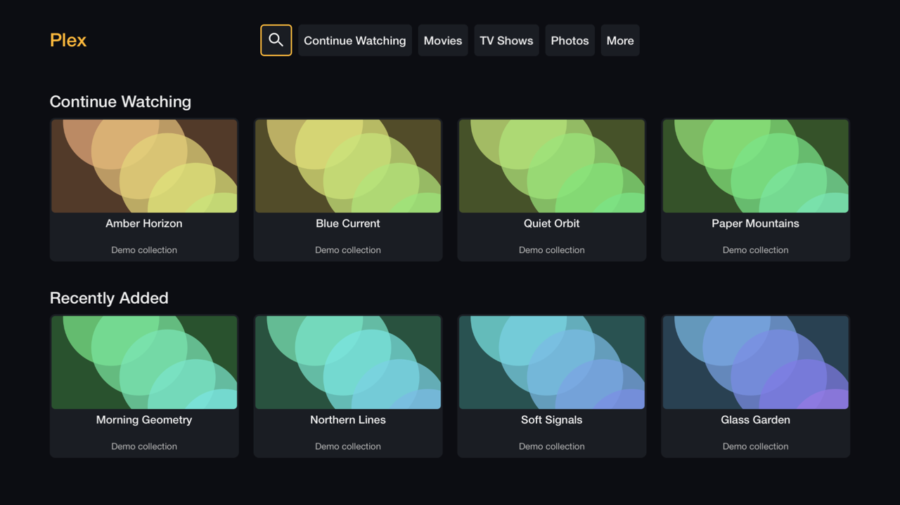
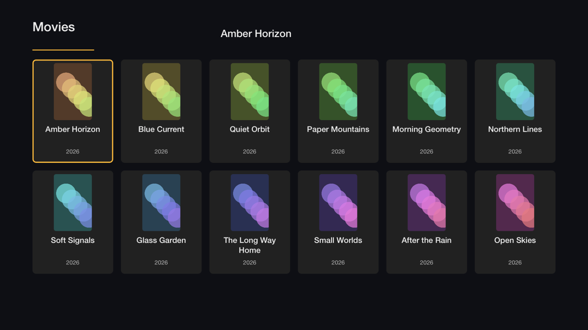
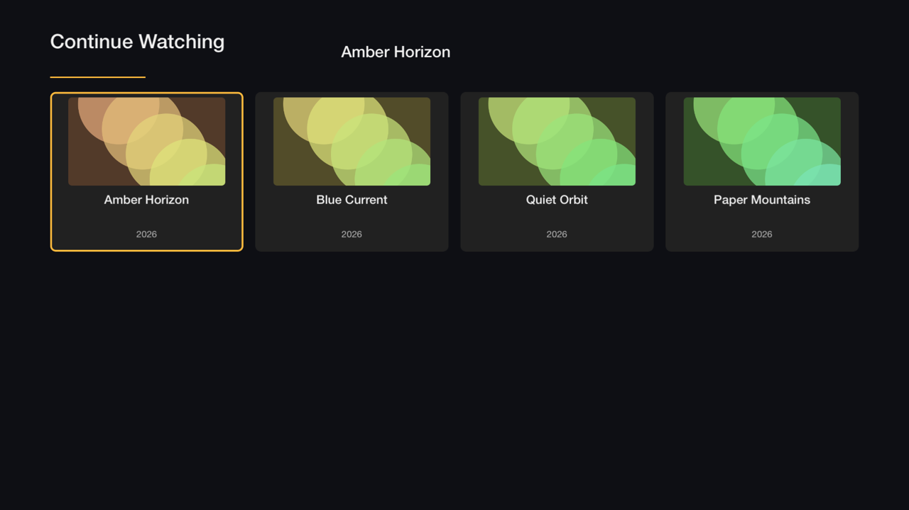

# RevivePlex

A community Plex media player for **jailbroken Apple TV 3 Rev A (A1469 / AppleTV3,2)**. Native BackRow interface, Plex libraries and the Apple TV system video player. Not an official Plex product and not a modern tvOS app.

**Jailbreak is required before installation.** A stock Apple TV cannot install this appliance. RevivePlex does not jailbreak the device, bypass media DRM, include media, or provide access to other people's libraries. You need your own Plex account and an accessible Plex Media Server.

## Compatibility

| Requirement | First release |
| --- | --- |
| Hardware | AppleTV3,2 / A1469; other models are untested |
| Firmware | Apple TV Software 7.9, build 12H1006 (iOS 8 family) |
| Device setup | Existing working jailbreak, SSH, MobileSubstrate and `beigelist` appliance loader |
| Tested loader | beigelist 2.2.6-30, MobileSubstrate 0.9.6301, Blackb0x-- 8.4.7 |
| Build host | macOS, full Xcode with iPhoneOS SDK, Python 3 |
| Media server | Accessible Plex Media Server; server transcoding required for unsupported formats |

Installing the bundle alone does **not** add an app to a stock Apple TV menu. Jailbreak and loader setup are prerequisites, not steps performed by this installer. Follow your jailbreak project's device/firmware-specific instructions. See [Blackb0x--](https://github.com/regulad/Blackb0x--) for background; do not assume every jailbreak ships the same loader.

## Screenshots

These are captures of the real application renderer using an isolated demonstration build. All titles and artwork are synthetic; no personal library, account, family photo or film/TV poster is included. The original geometric illustrations are dedicated to CC0; see [screenshot provenance](docs/SCREENSHOTS.md).





## Features

- Plex library names and home shelves, movie/series/season/episode browsing, cast and metadata.
- Live search with a compact remote keyboard; film and series results rather than individual episodes.
- Sorting, filters with selection/count indicators, collections and playlists.
- Full-screen native player, resume, playback progress, audio/subtitle options and supported intro/credits markers.
- Server conversion to H.264/AAC HLS where required; compatible video can retain its original resolution below the chosen quality ceiling.
- English, Türkçe, Svenska and Español. System language by default, English fallback; app and keyboard language can be selected independently.
- Plex sign-in using QR/link code. The existing account is retained across updates.

This is a **first preview release**, not complete parity with every Plex client. See [validation and limitations](docs/VALIDATION.md). Account/server features depend on Plex permissions and capabilities. Heavy 4K sources may require a faster server or an optimized version; this device does not gain 4K/HDR hardware support through transcoding.

## Install a release

1. Verify the device is already jailbroken, SSH works and `beigelist` is installed. Keep a working SSH connection available during installation.
2. Download the release archive and its `SHA256SUMS` from this repository's Releases page. While the repository is private, you must be signed into an account with access.
3. Check the archive checksum, then extract it:

```sh
shasum -a 256 -c SHA256SUMS
unzip RevivePlex-0.1.0-preview.1.zip
cd RevivePlex-0.1.0-preview.1
python3 tools/install.py root@APPLE_TV_IP --legacy-ssh --check
python3 tools/install.py root@APPLE_TV_IP --legacy-ssh --bundle RevivePlex.frappliance
```

Replace `APPLE_TV_IP` with your device's address. SSH asks for your device credentials; none are included or stored by the installer. `--legacy-ssh` enables the old device's RSA host-key algorithm without disabling host-key verification. Verify the host fingerprint before accepting a new host.

The installer checks the model, firmware and loader; uploads and verifies the binary; backs up any previous bundle; installs into `/Applications/AppleTV.app/Appliances/RevivePlex.frappliance`; then restarts the Apple TV interface. It does not change your Plex credentials or playback preferences. Open **RevivePlex** from the system menu (the in-app heading is **Plex**).

### USB SSH alternative

If network SSH is unavailable, connect the Apple TV's micro-USB port to the Mac and forward SSH with `iproxy` from libusbmuxd:

```sh
brew install libimobiledevice libusbmuxd
iproxy 2222:22
# In another terminal:
python3 tools/install.py root@127.0.0.1 --port 2222 --legacy-ssh --bundle RevivePlex.frappliance
```

For a device whose host key is already trusted under its LAN hostname, add `--host-key-alias APPLE_TV_IP`. Do not delete host keys merely to dismiss a mismatch.

## First launch and remote

Scan the QR code or visit the displayed Plex link and enter the activation code. Authorize the device with your own Plex account; select an accessible server if prompted. No manual token editing is needed for ordinary sign-in.

| Control | Action |
| --- | --- |
| Direction buttons | Move focus; left/right skip 10 seconds during playback (rapid taps combine into one target) |
| Select | Open an item; native playback control when watching |
| Hold Select | Open playback options; the on-screen bubble reminds you while transport controls are visible |
| Play/Pause | Pause or resume |
| Menu / Back | Return one screen; on Home, first focus Search, then exit when Search is already focused |

App language: **More → Settings → App language**. Video quality is an upper limit; **Preserve compatible video** avoids unnecessary video conversion where the codec, resolution, bitrate and subtitle requirements allow it. Audio may still be converted.

## Build and test

```sh
./native/build.sh
./native/tests/run.sh
python3 tools/install.py root@APPLE_TV_IP --legacy-ssh --bundle build/native/RevivePlex.frappliance
```

The builder uses local Xcode headers and generated symbol stubs to produce an ad-hoc signed ARMv7 bundle. Apple SDKs, operating-system binaries and jailbreak packages are not redistributed. The build does not contain account credentials or a preconfigured personal server.

Host tests exercise a local synthetic Plex server, parsing, navigation, language selection, filters, queues and playback decisions. They are not a substitute for HDMI/audio verification on hardware.

## Update, rollback and uninstall

Use the same installer for updates. It prints a backup directory for the previous bundle. To roll back, restore `RevivePlex.frappliance` from that directory to `/Applications/AppleTV.app/Appliances/`, preserving permissions, and restart `AppleTV` over SSH.

To uninstall, remove only `/Applications/AppleTV.app/Appliances/RevivePlex.frappliance` and restart `AppleTV`. Do not remove the loader or unrelated appliances. Account data lives in `/var/mobile/Library/Preferences/org.revivetv.plex.local.plist`; uninstall leaves it in place. Use in-app sign-out before uninstalling if you want the local session removed.

## Troubleshooting

- **No menu entry:** confirm the jailbreak's appliance loader and MobileSubstrate are active. A successful file copy alone is insufficient.
- **Blank screen after installation:** restore the saved bundle over SSH and restart the interface. Do not restore firmware as the first step.
- **Video takes too long:** inspect Plex server transcoding load; try a lower quality or an optimized version.
- **TLS/server connection error:** check server availability, device date and certificate configuration. Certificate verification is not disabled.
- **Sync issue:** report codec/container, quality, resume position, and whether it happens from the beginning or after seeking. Do not post tokens, activation codes, private server URLs, or raw account configuration.

## License and project status

Code: [MIT](LICENSE). Original demo illustrations: CC0 dedication in [SCREENSHOTS.md](docs/SCREENSHOTS.md). Plex and Apple names identify interoperability targets; their trademarks remain with their owners. No endorsement or affiliation is implied.

The repository is initially private. Making it public is the owner's decision.
